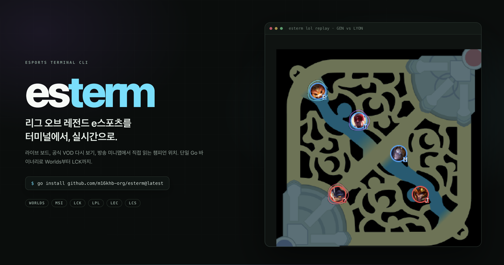
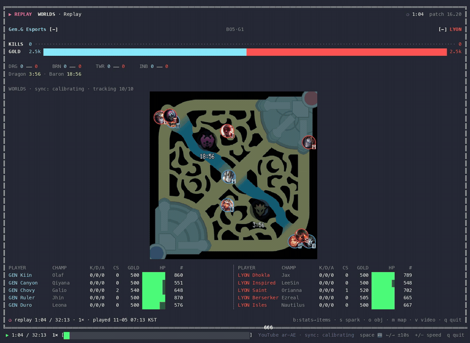
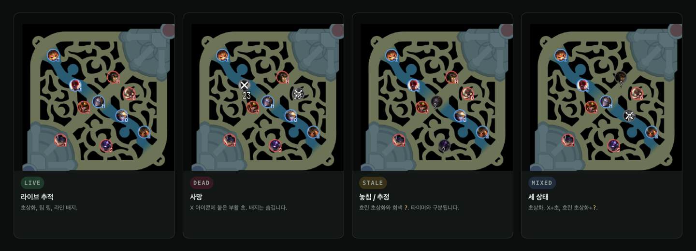
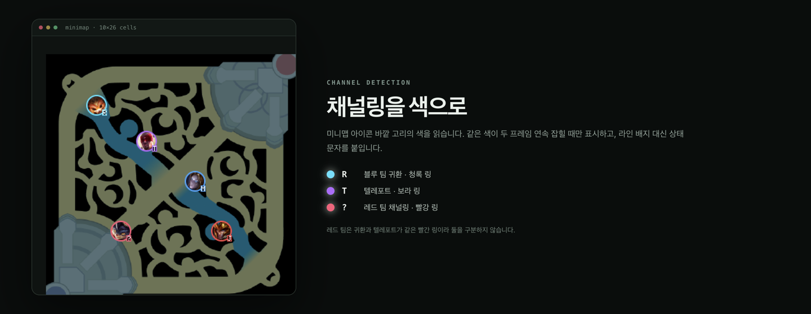

<h1 align="center">esterm</h1>

<p align="center">
  <strong>리그 오브 레전드 e스포츠를 터미널에서 보는 싱글 바이너리 CLI</strong><br />
  라이브 보드와 공식 VOD 다시 보기, 방송 미니맵에서 직접 읽는 챔피언 위치
</p>

<p align="center">
  <a href="README.md"><strong>한국어</strong></a>
  ·
  <a href="INSTALL.md">설치 가이드</a>
  ·
  <a href="https://m16khb-org.github.io/esterm/">웹 소개</a>
</p>

<p align="center">
  
</p>

<p align="center">
  <a href="docs/assets/demo.mp4"></a>
</p>

<p align="center">
  <a href="docs/assets/demo.mp4">실제 구동 영상 보기 (MP4, 15초)</a>
</p>

esterm은 프로 경기의 **일정·결과·실시간 인게임 보드**와 **지난 경기 다시 보기**를 터미널에서 보여 줍니다.
lolesports.com이 쓰는 비공식 엔드포인트를 사용하며, API 키는 사이트에 하드코딩된 공용 키라 따로 발급할 필요가 없습니다.

가장 큰 차별점은 **방송 미니맵을 직접 읽는 것**입니다. Riot의 스탯 피드에는 챔피언 좌표가 없습니다.
esterm은 공식 방송 VOD에서 미니맵 영역을 잘라 내고, 챔피언 초상화 템플릿 매칭·칼만 필터 추적·메인 뷰 체력바로
10명의 위치를 추정합니다. 사망, 놓친 챔피언, 귀환·텔레포트 채널링까지 색과 문자로 구분합니다.

[한눈에](#한눈에) · [빠른 시작](#빠른-시작) · [대화형 앱](#대화형-앱) ·
[미니맵](#미니맵) · [동기화](#동기화) · [검증](#검증) · [문제 해결](#문제-해결)

## 한눈에

| 기능 | 내용 |
|---|---|
| **라이브 보드** | 킬·골드 비례 바, 오브젝트 수, 선수별 KDA·CS·골드·HP 바, 0.5초 갱신 |
| **다시 보기** | 공식 VOD 영상과 livestats 피드를 같은 게임 시각에 맞춰 재생. `Space`·`←`·`→`·배속 지원 |
| **방송 미니맵** | 공식 1080p 방송 4종(Worlds·LCK·LPL·LEC) 레이아웃 자동 인식, 초당 5프레임 추적 |
| **상태 표시** | 사망 `✕`+부활 초, 놓침은 흐린 초상화+`?`, 귀환 `R`·텔레포트 `T` |
| **오브젝트 타이머** | 용·엘더·바론의 다음 등장 시각과 소울 포인트 |
| **반응형 TUI** | lazygit 스타일 창, 50~200컬럼까지 자동 재배치 |
| **단일 바이너리** | Go 표준 라이브러리만 사용. 외부 의존성은 미니맵용 `yt-dlp`·`ffmpeg`·JS 런타임뿐 |

## 빠른 시작

필수 환경은 **Go 1.21 이상**입니다. 미니맵을 쓰려면 `yt-dlp`, `ffmpeg`, JS 런타임(`deno` 권장, 없으면 `bun` 또는 `node`)이 필요합니다.

```bash
go install github.com/m16khb-org/esterm@latest
# $(go env GOPATH)/bin 이 PATH 에 있어야 합니다

esterm                              # 대화형 앱
esterm lol replay                   # 최근 종료 경기와 -match 에 쓸 id 목록
esterm lol replay -match 115660588583040710 -g 1
esterm lol relay -l msi             # MSI 풀스크린 실시간 중계
```

소스에서 빌드하려면:

```bash
git clone https://github.com/m16khb-org/esterm.git
cd esterm
mkdir -p ~/.local/bin
go build -o ~/.local/bin/esterm .
```

미니맵 의존성은 macOS에서 `brew install yt-dlp ffmpeg deno`, Linux는 `apt install ffmpeg`와 `pipx install yt-dlp`로 설치합니다.
자세한 사전 점검·PATH·검증 절차는 **[INSTALL.md](INSTALL.md)** 에 있습니다.

## 대화형 앱

인자 없이 `esterm`을 실행하면 키보드만으로 쓰는 앱이 열립니다. 왼쪽에 `[1] Leagues`, `[2] Matches`, `[3] Games` 목록이 쌓이고,
오른쪽 `[0]` 창은 선택한 경기의 미리보기나 실행 중인 보드를 보여 줍니다.

| 키 | 동작 |
|---|---|
| `j` `k` / `↑` `↓` | 목록 이동 |
| `h` `l` / `←` `→` | 이전·다음 창 |
| `Tab` / `1` `2` `3` `0` | 창 포커스 이동 |
| `[` `]` | Matches 탭 전환 (Live / Upcoming / Recent) |
| `Enter` | 열기 (리그 → 경기 → 세트 → 보드) |
| `,` | 옵션 메뉴 (미니맵 그리기, 영상 동기화, 폴링 간격) |
| `?` | 현재 문맥의 키 도움말 |
| `q` / `Ctrl+C` | 종료 |

보드에 포커스가 있을 때는 `Space` 일시정지, `←` `→` ±10초, `+` `-` 배속, `b` stats→items→runes,
`s` 골드 스파크라인, `o` 오브젝트 맵, `m` 미니맵 패널, `v` 방송 영상 동기화, `f` 확대를 씁니다.

## 미니맵

`m` 토글 또는 `esterm lol minimap`은 방송 영상의 미니맵에서 챔피언 위치를 직접 검출합니다.
검출은 순수 Go로 합니다: Data Dragon/CommunityDragon 초상화 템플릿, 헝가리안 배정, 칼만 필터, 메인 뷰 체력바 융합.

<p align="center">
  
</p>

| 상태 | 표시 |
|---|---|
| 라이브 | 초상화 + 팀 색 링 + 라인 배지 `T` `J` `M` `B` `S` |
| 사망 | 회색 X 아이콘 + 아이콘에 붙은 부활 초. 피드의 사망 수로 판단합니다 |
| 놓침 | 흐린 초상화 + 회색 `?`. 마지막 측정 위치를 추정해 유지합니다 |
| 귀환 | 청록 링 + `R` (블루 팀), 빨강 링 (레드 팀) |
| 텔레포트 | 보라 링 + `T` |
| 레드 팀 채널링 | 빨강 링 + `?` |

<p align="center">
  
</p>

채널링은 아이콘 바깥 고리의 **색**을 읽어 판정합니다. 같은 색이 2프레임 연속 잡혀야 인정합니다.
레드 팀은 귀환과 텔레포트가 같은 빨간 링이라 둘을 구분하지 않습니다.

```bash
esterm lol minimap -src https://www.youtube.com/watch?v=UWBRuboiCXk \
  -ss 1500 -game 115660588583040711 -n 20 -json
```

`-json`은 프레임마다 한 줄을 출력합니다. `present`(레이아웃 잠금), `clock`, `kills`, `visible`,
`champions[{pid,champ,role,team,visible,x,y,score,chan}]`을 담습니다. 좌표는 게임 단위입니다.

## 동기화

방송 화면과 피드의 시각을 맞추는 것이 미니맵·점수판·헤더의 기준입니다.

- **지원 화면**: Worlds, LCK, LPL, LEC의 공식 1080p 방송. 상단 게임 시계 글꼴로 레이아웃을 자동 판별합니다.
- **계속 재보정**: 방송 시계(`mm:ss`)와 킬 카운터 변화를 피드의 킬 이벤트와 대조해 오프셋을 갱신합니다.
- **첫 잠금**: 약 5초. 그동안 상태 줄은 `sync: calibrating`입니다.
- **화면 전환**: 리플레이·데스크·밴픽처럼 라이브 미니맵이 없으면 챔피언을 숨기고
  `no live minimap (broadcast replay/desk)`를 노란색으로 표시합니다. 라이브로 돌아오면 다시 나타납니다.
- **영상 정지**: 8초 넘게 멎으면 피드만 재생하고 `video stalled`로 표시합니다.

## 오브젝트 타이머

보드의 오브젝트 행 아래에 용 구덩이와 바론 구덩이의 다음 등장 시각을 한 줄로 보여 줍니다.

```text
DRG 2 ── 4 ★SOUL     BRN 0 ── 1     TWR 4 ── 7     INB 0 ── 1
Dragon 3:12 Infernal · Baron UP · Soul point blue
```

용 첫 등장 5:00, 재등장 5:00, 장로 6:00, 바론 첫 등장 20:00·재등장 6:00을 게임 시계에 더해 계산합니다.
일시정지 구간은 게임 시계가 멈추는 만큼 타이머도 멈춥니다.

## 검증

완료된 공식 경기 16경기(Worlds 7, LCK 3, LPL 3, LEC 3)를 방송 영상 전체로 돌리는 백테스트가 있습니다.
앱과 같은 `mmPipeline`·`mmSync`·사망 로직을 사용하고, livestats 피드를 정답으로 삼습니다.

```bash
go test -tags backtest -run TestBacktest -timeout 3h -v . -backtest.out=/tmp/backtest.json
```

| 리그 | 경기 | 생존 검출 | 죽은 챔피언 오검출 | 킬 플립 ≤1초 | 5초↑ 공백(건/초) |
|---|---|---|---|---|---|
| worlds | 7 | 약 94.4% | 0.00% | 98.0% | 532/11498 |
| lck | 3 | 94.2% | 0.00% | 97.5% | 299/6536 |
| lpl | 3 | 91.2% | 0.00% | 91.7% | 256/5364 |
| lec | 3 | 95.8% | 0.00% | 100% | 249/4708 |
| **전체** | **16** | **약 94.0%** | **0.00%** | **97.2%** | **1336/28106** |

- 16경기 중 13경기가 기준을 통과했습니다.
- 부활 추정 중앙값 0.24초·p90 0.45초, 시계 판독 94.8~98.9%, 틀린 재잠금 0회.
- 프로세스 CPU는 프레임당 21~28ms(5fps, 메인 뷰 포함)로 영상 시간의 7.5~9.2배 속도입니다.

자세한 측정 기준과 경기별 수치는 **[구현 상세](docs/internals.md)** 에 있습니다.

## 터미널 설정

`-icons auto|kitty|blocks|text` (기본 `auto` = kitty → blocks → text).

| 모드 | 내용 |
|---|---|
| `kitty` | 픽셀 지도 + 챔피언 초상화. kitty, Ghostty, WezTerm, herdr에서 동작 |
| `blocks` | 트루컬러 반블록 지도 + 라인 글자. 작은 화면에 적합 |
| `text` | 점자 지도 + 라인 글자. 트루컬러가 없을 때의 마지막 대안 |

`auto`는 `TERM_PROGRAM`(ghostty/wezterm/herdr), `KITTY_WINDOW_ID`, `TERM=xterm-kitty`를 보고 kitty를 고릅니다.
환경변수로 판단이 안 되면 시작할 때 kitty 그래픽 질의를 보내 최대 0.2초 기다립니다.

## 문제 해결

| 증상 | 확인할 내용 |
|---|---|
| `command not found: esterm` | `$(go env GOPATH)/bin` 또는 `~/.local/bin`이 PATH에 있는지 확인 |
| 미니맵이 `missing tools` | `brew install yt-dlp ffmpeg deno` 후 재실행 |
| `detecting broadcast layout`에서 멈춤 | 공식 1080p 방송인지 확인. 720p·공동 시청 방송은 시계를 읽지 못합니다 |
| 라이브 경기가 안 보임 | 방송이 아직 시작되지 않았을 수 있습니다. `esterm lol schedule`로 확인 |
| 미니맵이 잠깐 사라짐 | 리플레이·데스크·밴픽 화면이면 정상입니다. 상태 줄에 이유가 나옵니다 |
| 아이콘/아이템 이름이 오래됨 | `~/Library/Caches/esterm`(macOS) 또는 `~/.cache/esterm` 삭제 |
| 최근 경기 VOD가 재생되지 않음 | 라이브 아카이브 VOD는 seek할 수 없어 다음 VOD로 자동 전환합니다 |

## 더 알아보기

| 문서 | 용도 |
|---|---|
| [INSTALL.md](INSTALL.md) | 사전 점검, PATH, 미니맵 의존성, 검증 체크리스트 |
| [구현 상세](docs/internals.md) | 미니맵 파이프라인, 동기화, 백테스트 전체 수치, 데이터 소스 |
| [.issueops/ARCHITECTURE.md](.issueops/ARCHITECTURE.md) | 구조와 설계 결정 |
| [.issueops/TESTING.md](.issueops/TESTING.md) | 검증 기준 |
| [웹 소개](https://m16khb-org.github.io/esterm/) | 스크린샷과 설치 안내 |

> lolesports.com의 비공식 엔드포인트를 사용합니다. 영상은 **개인 시청 목적**으로만 처리하며,
> 녹화·저장·재배포하지 마세요. 각 플랫폼의 약관을 따릅니다.

## 라이선스

GPL-3.0-or-later. 전문은 [LICENSE](LICENSE)를 참고합니다.

Copyright (C) 2026 m16khb

This program is free software: you can redistribute it and/or modify
it under the terms of the GNU General Public License as published by
the Free Software Foundation, either version 3 of the License, or
(at your option) any later version.

This program is distributed in the hope that it will be useful,
but WITHOUT ANY WARRANTY; without even the implied warranty of
MERCHANTABILITY or FITNESS FOR A PARTICULAR PURPOSE.  See the
GNU General Public License for more details.

You should have received a copy of the GNU General Public License
along with this program.  If not, see <https://www.gnu.org/licenses/>.
